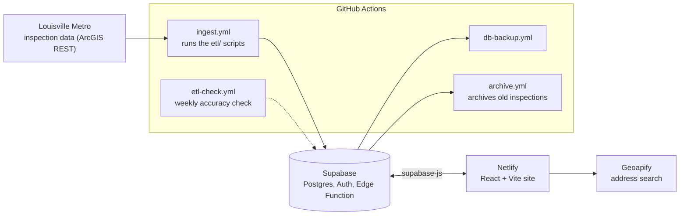

# Louisville Food Safe

[](https://github.com/<your-github-username>/Louisville-Health-Inspection-Map/actions/workflows/ci.yml)
[](LICENSE)

**Live site: https://louisvillefoodsafe.netlify.app**

An interactive map of health inspection scores for restaurants and other food service establishments in Louisville, KY. It pulls Louisville Metro's open inspection data on a schedule and makes it easy to browse: pins colored by score, full inspection histories, and the specific violations behind each score.

<!-- Add screenshots to docs/images/, then uncomment:


-->

## What you can do

- **Browse the map.** Pins are colored by score band (red, yellow, green, or N/A). Pick a preset or drag the sliders to set where the bands start, filter by facility category, limit by how recent the inspection is, and search by name or address.
- **Open any place** to see its latest score, grade and date, its full inspection history, and the violations from each visit, with critical ones called out and the inspector's comments.
- **See what's new.** A panel lists recent inspections with critical violations, plus the latest perfect scores.
- **Use the table view** for a sortable, filterable list with paging.
- **Save places and watch areas.** Sign in with a one-time email code to bookmark restaurants, or to watch a radius (1, 3, 5 or 10 miles) around an address and see the places inside it, sorted by critical violations first.
- **Spot duplicate listings.** When the city re-files a permit under a slightly different name at the same spot, the records are linked ("may also be listed as") instead of being merged or hidden.
- **Use it on a phone.** The inspection drawer is a bottom sheet that rests low so you can still see the map, and drags up for more.
- Read more on the **Learn** page, which includes a violation database, or send feedback from the site.

## How it works



- **ETL** (`etl/`): Node scripts fetch inspection records from the city's ArcGIS REST API and load facilities, inspections, violations and categories into Supabase. Each run is recorded, so a failed or partial sync can be recovered. Missing coordinates are filled in by a geocoding step.
- **Checks:** a weekly job (`scripts/etl-accuracy-check.js`) runs an accuracy check on the loaded data. A separate job backs the database up.
- **Frontend** (`InspectionWebsite/`): a React app that reads from Supabase and draws the map with MapLibre GL. Accounts use Supabase Auth with email one-time codes, and feedback goes through a rate-limited Supabase Edge Function.
- **Database:** views and functions live in `supabase/migrations/`.

More detail, with module diagrams, is in [docs/ARCHITECTURE.md](docs/ARCHITECTURE.md).

## Tech

React 19 and Vite 7 · MapLibre GL · Supabase (Postgres, Auth, Edge Functions) · Netlify · GitHub Actions · Geoapify for address search · Vitest and ESLint

## Run it locally

You need Node 20.19 or newer, and a Supabase project to read from.

```bash
cd InspectionWebsite
cp .env.example .env     # Windows: copy .env.example .env, then fill in the values
npm ci
npm run dev
```

Other scripts, all from `InspectionWebsite/`:

```bash
npm run lint
npm test
npm run build
```

The ETL has its own package: `cd etl && npm ci && npm test`. Its scripts use a Supabase service-role key, which must stay out of the frontend and out of git.

## Project layout

```
InspectionWebsite/   React app
  src/lib/           pure logic (scoring, categories, duplicate detection, bottom-sheet rules...), each with tests
  src/hooks/         shared React hooks
  src/styles/        component stylesheets
etl/                 data pipeline and its tests
scripts/             maintenance jobs (accuracy check, archiving)
supabase/            migrations and the feedback edge function
docs/                architecture notes and a manual smoke-test checklist
.github/workflows/   CI, ingest, backup, archive and accuracy-check jobs
```

## Testing

CI runs lint, the unit tests and a production build on every push and pull request. The unit tests cover the logic layer in `src/lib`: score bands, category rules, duplicate-place detection, date and address helpers, pan limits and the phone bottom-sheet rules. The React components are checked by hand with [docs/SMOKE_TEST.md](docs/SMOKE_TEST.md). The ETL tests run with `npm test` in `etl/`.

## About the data

Inspection data comes from [Louisville Metro Open Data](https://data.louisvilleky.gov/) through its ArcGIS REST API. It is refreshed periodically and may not reflect the very latest inspections. This project is independent and is not affiliated with Louisville Metro Government.

## License

MIT. See [LICENSE](LICENSE).
