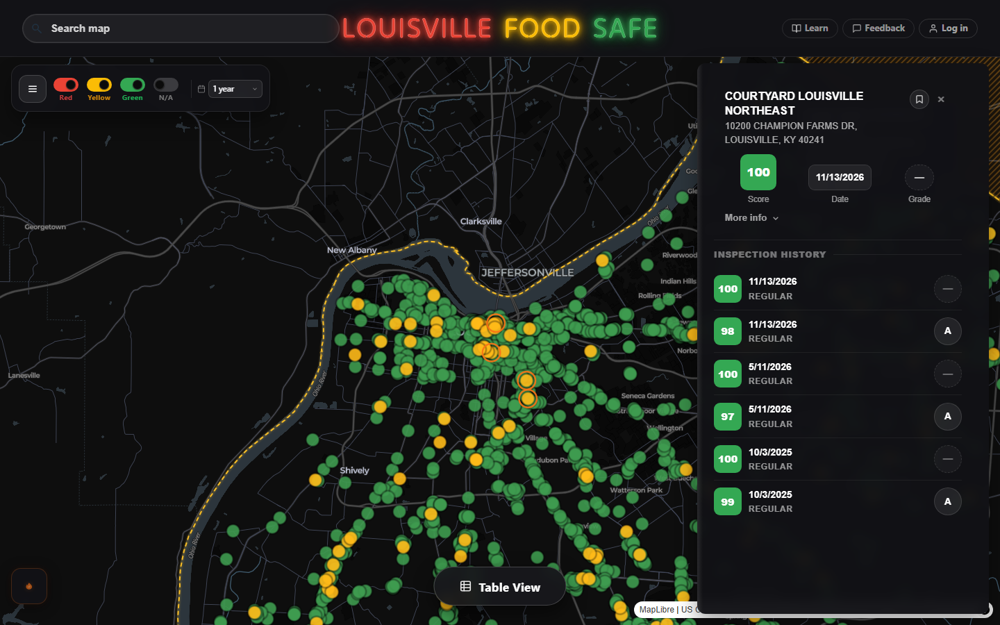
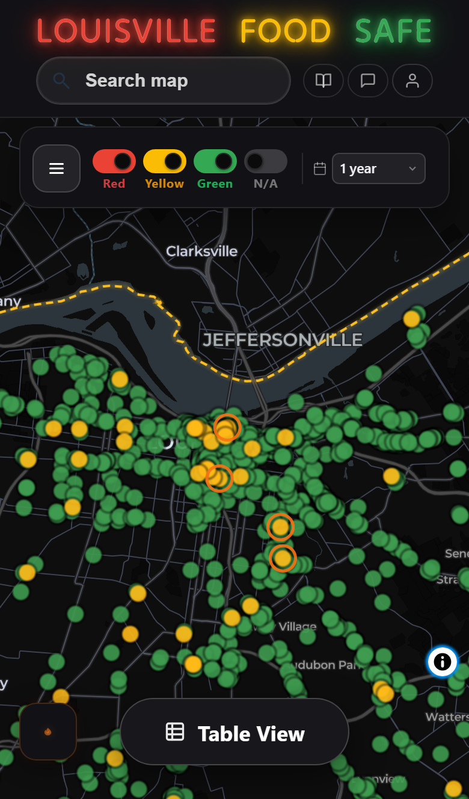
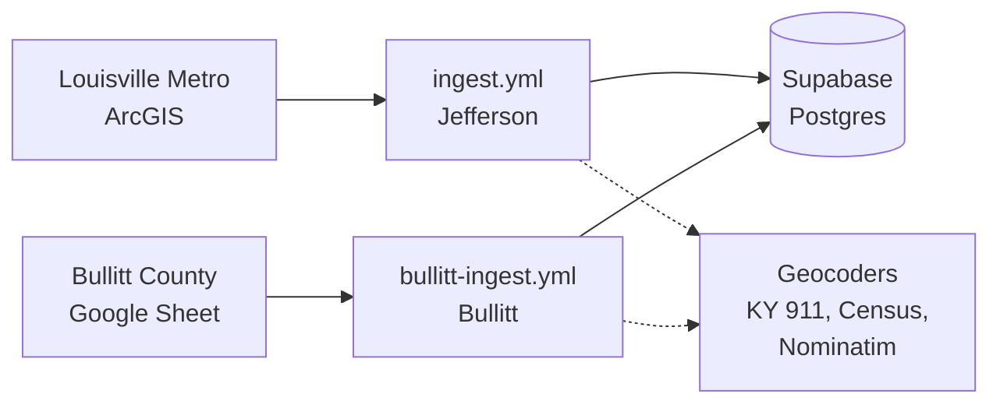
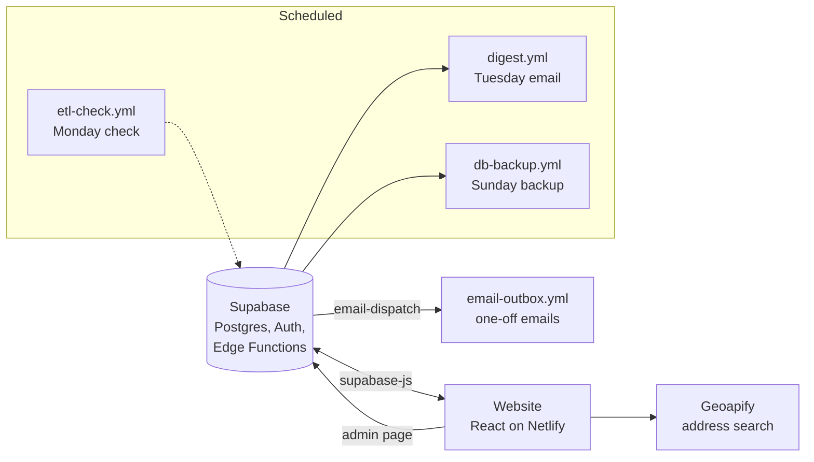

# Louisville Food Safe

[](https://github.com/AndyGutterman/Louisville-Health-Inspection-Map/actions/workflows/ci.yml)
[](LICENSE)

**Live site: https://louisvillefoodsafe.netlify.app**

An interactive map of health inspection scores for restaurants and other food service establishments in Louisville, KY (Jefferson County), with Bullitt County next door. It loads each county's public inspection data every day and makes it easy to browse: pins colored by score, full inspection histories, and the specific violations behind each score.

<p align="center">
  
  
</p>

## What you can do

- **Browse the map.** Pins are colored by score band (red, yellow, green, or N/A). Pick a preset or drag the sliders to set where the bands start, filter by facility category, limit by how recent the inspection is, and search by name or address.
- **Open any place** to see its latest score, grade and date, its full inspection history, and the violations from each visit with the inspector's comments.
- **See what's new.** A panel lists the latest inspections, the same ones failing first, and the latest perfect scores.
- **Use the table view** for a sortable, filterable list with paging.
- **Save places and watch areas.** Sign in with a one-time email code to bookmark restaurants, or to watch a radius (1, 2, 3 or 5 miles) around an address and see the places inside it, sorted with the ones that need attention first. A weekly digest email (Tuesdays, opt-in) sums up the week and each watch area.
- **Spot duplicate listings.** When the city re-files a permit under a slightly different name at the same spot, the records are linked ("may also be listed as") instead of being merged or hidden.
- **Use it on a phone.** The inspection drawer is a bottom sheet that rests low so you can still see the map, and drags up for more.
- Read more on the **Learn** page, which includes a violation database, or send feedback from the site.

## How it works

### Data in: two counties, two jobs that load only what changed



| County    | Source                                       |
| --------- | -------------------------------------------- |
| Jefferson | Louisville Metro's ArcGIS feeds              |
| Bullitt   | The Bullitt County Health Department's sheet |

Both jobs check their source every two hours and load only when it has changed: Jefferson's check asks the city's servers for row counts and sums and reads nothing from the database (`pipeline/source_check.js`), and Bullitt's compares the sheet with the last copy. A load stamps `data_loads`, and visitors' saved pins are read again on their next visit after that, not before.

Each job writes only its own tables. The Bullitt job also refuses a source that looks broken (changed columns, a county under half its usual size), so the last good data stays up; Jefferson's job has no such check yet. Places without coordinates are geocoded (dashed lines), and the results are cached in the database. More in [docs/BULLITT.md](docs/BULLITT.md).

A reader for Kentucky's statewide inspection portal (more counties, with dates) is built but paused until there is permission to use it: [docs/COUNTIES.md](docs/COUNTIES.md).

### Data out, and the jobs around it



- **Pipeline** (`pipeline/`): Node scripts load each county into Supabase. Every run is recorded, so a failed or partial sync can be recovered (`Recover.js`).
- **Website** (`apps/web/`): reads pins, inspections and violations through `supabase-js` and draws the map with MapLibre GL. Each county and each place type loads only when it's switched on, and is kept in the browser until that county's data is loaded again (`data_loads`). Accounts use email one-time codes, and feedback goes through a rate-limited edge function.
- **Emails:** the weekly digest (Tuesdays) and one-off emails from the admin page are sent by GitHub Actions with the same code (`packages/core/email/`).
- **Upkeep:** a weekly backup of the tables that can't be rebuilt (db-backup.yml) and a weekly accuracy check of the loaded data (etl-check.yml).
- **Database:** tables, views and functions live in `supabase/migrations/`.

More detail, with module diagrams, is in [docs/ARCHITECTURE.md](docs/ARCHITECTURE.md).

## Tech

React 19 and Vite 7 · MapLibre GL · Supabase (Postgres, Auth, Edge Functions) · Netlify · GitHub Actions · Geoapify for address search · Vitest and ESLint

## Run it locally

You need Node 22 (see `.nvmrc`) and a Supabase project to read from. Everything runs from the repository root, which is an npm workspace: one `npm ci` installs the website, the pipeline and the code they share.

```bash
npm ci
cp apps/web/.env.example apps/web/.env   # Windows: copy appsweb.env.example appsweb.env, then fill in the values
npm run dev
```

Other scripts, all from the root:

```bash
npm run lint
npm test          # website and pipeline tests
npm run build
npm run format    # Prettier
```

The pipeline scripts use a Supabase service-role key (in `pipeline/.env` locally, GitHub secrets in Actions), which must stay out of the frontend and out of git.

## Project layout

```
apps/web/            the website (React app)
  src/Map.jsx        the app shell: which panels are open, and the layout
  src/features/map/  the map, its popups and the data behind it (hooks)
  src/api/           Supabase calls
  src/lib/           pure logic (scoring, categories, filters, duplicate detection, bottom-sheet rules...), each with tests
  src/hooks/         shared React hooks
  src/styles/        component stylesheets
packages/core/       rules shared by the website and the pipeline (the emails), with tests
pipeline/            data pipeline, maintenance jobs (accuracy check, archiving) and their tests
supabase/            full database schema (migrations) and the edge functions (feedback, email dispatch)
docs/                architecture notes and a manual smoke-test checklist
.github/workflows/   CI, e2e, the three ingest jobs, emails, backup and accuracy check
```

## Testing

CI runs lint, the unit tests and a production build on every push and pull request, and Playwright runs the site on a desktop and a phone screen against each pull request's Netlify preview, with screenshots posted to the PR.

- **Unit tests** (`npm test`): the logic layer in `apps/web/src/lib` (score bands, categories, search, duplicate places, map filters and caching, paging, dates, the phone bottom sheet, and more; about 98% of its lines, `npm run test:coverage`), the shared rules and emails in `packages/core`, and the pipeline.
- **Component tests** with Testing Library, starting with What's New.
- **End-to-end tests** (`npm run e2e`): Supabase is mocked with fixed data, so they never touch the database.
- What the automated tests can't see is checked by hand with [docs/SMOKE_TEST.md](docs/SMOKE_TEST.md).

## About the data

Inspection data comes from each county's public records: [Louisville Metro Open Data](https://data.louisvilleky.gov/) (its ArcGIS REST API) for Jefferson County, and the Bullitt County Health Department's published sheet for Bullitt County. It is checked for updates every two hours, but each source publishes on its own schedule (Louisville about a week behind), so it may not reflect the very latest inspections. This project is independent and is not affiliated with Louisville Metro Government or any county health department.

## License

MIT. See [LICENSE](LICENSE).
