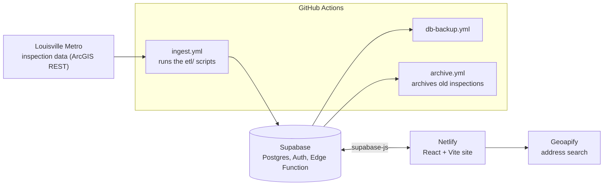
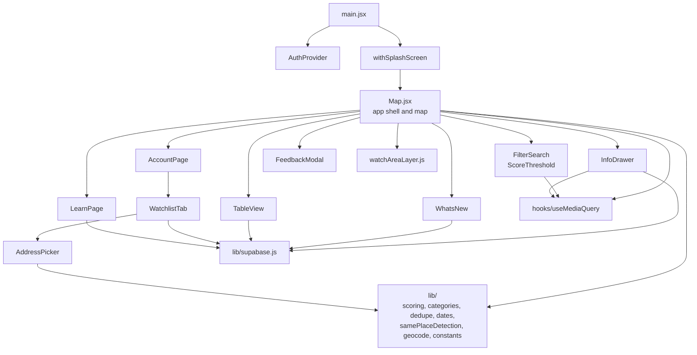
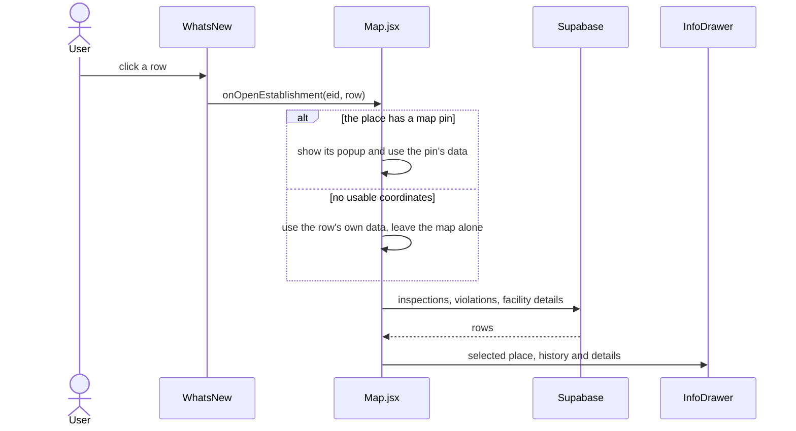

# Architecture

Louisville Food Safe is a map of Louisville Metro food-establishment inspections. A set of scripts pulls the city's data into a Supabase database, and a React site reads it.

## System overview

- **Data in:** the scripts in `etl/` fetch the city's data and write it to Supabase. `etl/tests/` covers the helpers.
- **Data out:** the site reads pins, inspections and violations through `supabase-js`. Accounts use email one-time codes, and watchlists and watch areas are stored per user.
- **Feedback:** the feedback form posts to the `submit-feedback` edge function (`supabase/functions/`), which rate-limits by IP.
- **Address search** for watch areas calls Geoapify directly from the browser.

## Frontend modules

`src/lib/` is pure logic and is fully unit tested. Everything above it is UI.

## Example: clicking a row in What's New

## Where do I change...?

| I want to change | Look in |
|---|---|
| Score colours, presets, red/yellow/green bands | `src/lib/scoring.js` |
| Which facility types belong to a category | `src/lib/categories.js` |
| How "may also be listed as" duplicates are detected | `src/lib/samePlaceDetection.js` |
| How pins sharing one location are collapsed | `src/lib/dedupe.js` |
| Date formats | `src/lib/dates.js` |
| Address search for watch areas | `src/lib/geocode.js`, `src/AddressPicker.jsx` |
| Phone / desktop breakpoints in components | `src/hooks/useMediaQuery.js` |
| The info drawer and its history | `src/InfoDrawer.jsx`, `src/styles/RestaurantInfo.css`, `History.css`, `Violations.css` |
| Filters and score sliders | `src/FilterSearch.jsx`, `src/ScoreThreshold.jsx`, `src/styles/AdjustFilter.css` |
| Watch areas on the map | `src/watchAreaLayer.js` |
| Watchlist and account panel | `src/AccountPage.jsx`, `src/WatchlistTab.jsx` |
| Nightly data load | `etl/`, `.github/workflows/ingest.yml` |
| Database views and functions | `supabase/migrations/` |
