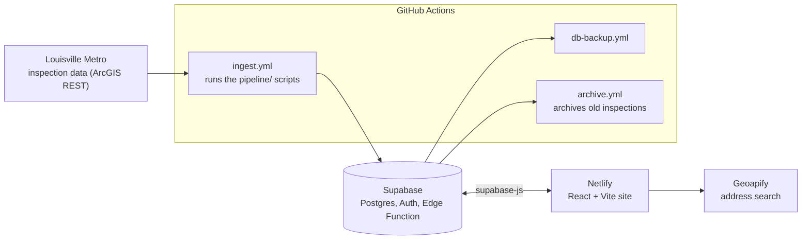
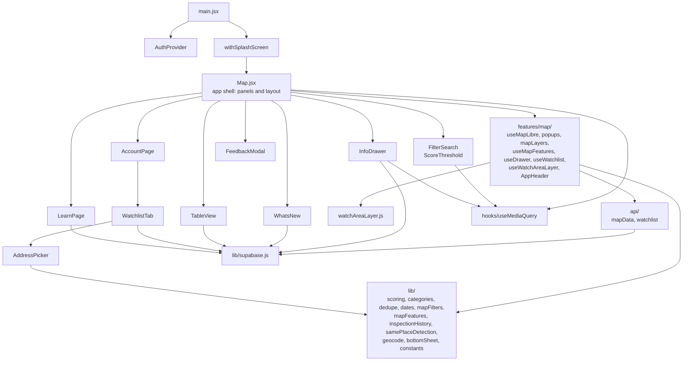
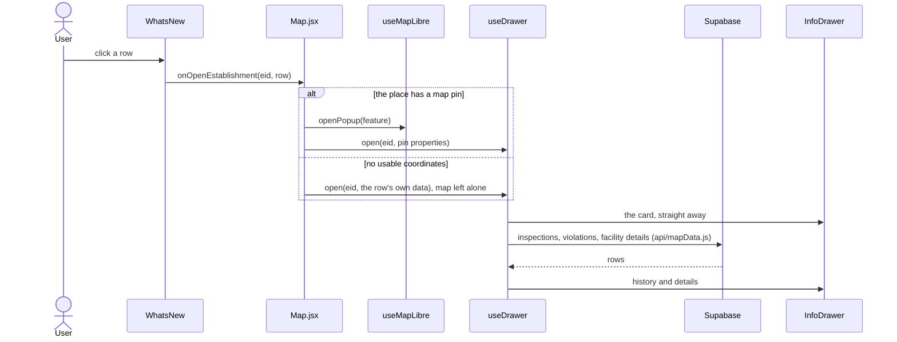

# Architecture

Louisville Food Safe is a map of Louisville Metro food-establishment inspections. A set of scripts pulls the city's data into a Supabase database, and a React site reads it.

## System overview

- **Data in:** the scripts in `pipeline/` fetch the city's data and write it to Supabase. `pipeline/tests/` covers the helpers.
- **Data out:** the site reads pins, inspections and violations through `supabase-js`. Accounts use email one-time codes, and watchlists and watch areas are stored per user.
- **Feedback:** the feedback form posts to the `submit-feedback` edge function (`supabase/functions/`), which rate-limits by IP.
- **Address search** for watch areas calls Geoapify directly from the browser.

## Frontend modules

`src/lib/` is pure logic and is fully unit tested. `features/map/` holds the map and the data behind it, as hooks that the shell (`Map.jsx`) wires together. The other components under `src/` are the panels.

## Example: clicking a row in What's New

## Where do I change...?

Website paths below are relative to `apps/web/`.

| I want to change                                              | Look in                                                                                |
| ------------------------------------------------------------- | -------------------------------------------------------------------------------------- |
| Score colours, presets, red/yellow/green bands                | `src/lib/scoring.js`                                                                   |
| Which facility types belong to a category                     | `src/lib/categories.js`                                                                |
| How "may also be listed as" duplicates are detected           | `src/lib/samePlaceDetection.js`                                                        |
| How pins sharing one location are collapsed                   | `src/lib/dedupe.js`                                                                    |
| Date formats                                                  | `src/lib/dates.js`                                                                     |
| Address search for watch areas                                | `src/lib/geocode.js`, `src/AddressPicker.jsx`                                          |
| Phone / desktop breakpoints in components                     | `src/hooks/useMediaQuery.js`                                                           |
| Phone info drawer: peek / expanded heights and the drag rules | `src/lib/bottomSheet.js`, `src/InfoDrawer.jsx`                                         |
| Map pan limits                                                | `src/lib/mapBounds.js`                                                                 |
| Date-filter options and the map data cache settings           | `src/lib/constants.js`                                                                 |
| Styles for a component                                        | `src/styles/<Component>.css` (imported by the component)                               |
| Which layer is on top on phones (account page vs info drawer) | `mobileTop` in `src/Map.jsx`                                                           |
| The info drawer and its history                               | `src/InfoDrawer.jsx`, `src/styles/RestaurantInfo.css`, `History.css`, `Violations.css` |
| Filters and score sliders                                     | `src/FilterSearch.jsx`, `src/ScoreThreshold.jsx`, `src/styles/AdjustFilter.css`        |
| Watch areas on the map                                        | `src/features/map/useWatchAreaLayer.js`, `src/watchAreaLayer.js` (the editor)          |
| Map popups (hover, pinned, "1 of 3", Table View row)          | `src/features/map/popups.jsx`                                                          |
| Pin and ring layers, and how the filters apply to them        | `src/features/map/mapLayers.js`, `src/lib/mapFilters.js`                               |
| Clicking pins, closing the drawer on outside clicks, edge pan | `src/features/map/useMapLibre.js`                                                      |
| Loading the pins (and the session cache)                      | `src/features/map/useMapFeatures.js`, `src/api/mapData.js`, `src/lib/mapFeatures.js`   |
| What the info drawer loads                                    | `src/features/map/useDrawer.js`, `src/lib/inspectionHistory.js`                        |
| Saving places, watch-area data                                | `src/features/map/useWatchlist.js`, `src/api/watchlist.js`                             |
| The header bar                                                | `src/features/map/AppHeader.jsx`                                                       |
| Watchlist and account panel                                   | `src/AccountPage.jsx`, `src/WatchlistTab.jsx`                                          |
| Nightly data load                                             | `pipeline/`, `.github/workflows/ingest.yml`                                            |
| Database tables, views, functions and security rules          | `supabase/migrations/` (start with the baseline file)                                  |
