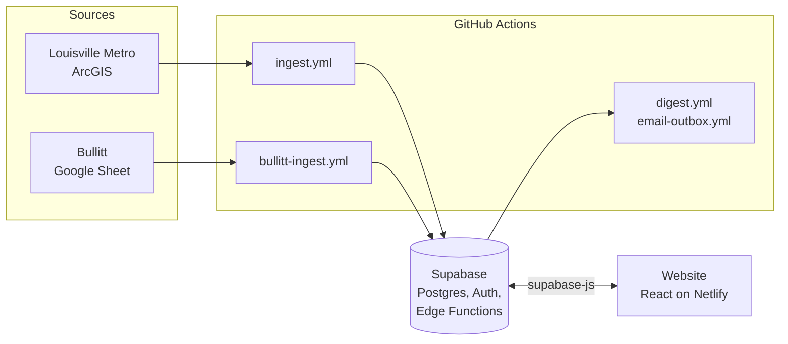
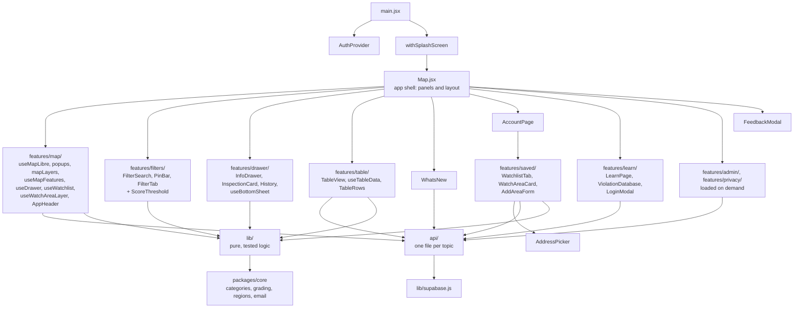
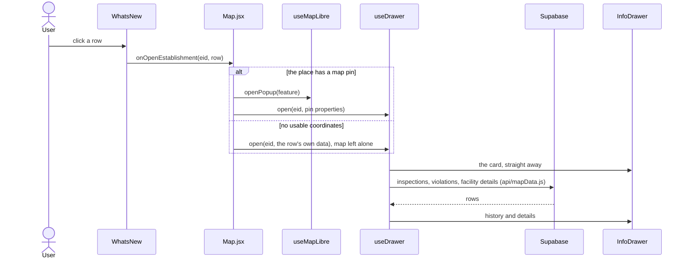

# Architecture

Louisville Food Safe is a map of food-establishment inspections in Jefferson County (Louisville Metro) and Bullitt County. Jobs check each county's public data every two hours and load it into a Supabase database when it has changed, and a React site reads it.

## System overview

The README's [How it works](../README.md#how-it-works) draws both halves in more detail: which source feeds which county, the fallbacks (connected and not), geocoding, and the scheduled backup, check and archive jobs.

- **Data in:** each county has its own job and its own tables (Jefferson: `facilities`, `inspections`, `inspection_violations`; Bullitt: `bullitt_*`; the paused portal counties: `portal_*`, docs/COUNTIES.md). `pipeline/tests/` covers the helpers.
- **Data out:** the site reads pins, inspections and violations through `supabase-js` (every query is in `apps/web/src/api/`). Accounts use email one-time codes, and saved places and watch areas are stored per user.
- **Emails:** `packages/core/email/` builds the weekly digest and one-off emails; the admin page's preview uses the same function as the send.
- **Feedback:** the feedback form posts to the `submit-feedback` edge function (`supabase/functions/`), which rate-limits by IP.
- **Address search** for watch areas calls Geoapify directly from the browser.

## Frontend modules

`src/lib/` is pure logic, unit tested beside each file. `features/` has one folder per part of the screen; `features/map/` holds the map and the data behind it, as hooks that the shell (`Map.jsx`) wires together. Every Supabase query lives in `api/`, so components never call the database themselves. `packages/core` holds what the website and the pipeline share.

## Example: clicking a row in What's New

## Where do I change...?

Website paths below are relative to `apps/web/`.

| I want to change                                                | Look in                                                                                  |
| --------------------------------------------------------------- | ---------------------------------------------------------------------------------------- |
| Score colours, presets, red/yellow/green bands                  | `src/lib/scoring.js`                                                                     |
| Which facility types belong to a category                       | `src/lib/categories.js`                                                                  |
| How "may also be listed as" duplicates are detected             | `src/lib/samePlaceDetection.js`                                                          |
| How pins sharing one location are collapsed                     | `src/lib/dedupe.js`                                                                      |
| Date formats                                                    | `src/lib/dates.js`                                                                       |
| Address search for watch areas                                  | `src/lib/geocode.js`, `src/AddressPicker.jsx`                                            |
| Phone / desktop breakpoints in components                       | `src/hooks/useMediaQuery.js`                                                             |
| Phone info drawer: peek / expanded heights and the drag rules   | `src/lib/bottomSheet.js`, `src/features/drawer/useBottomSheet.js`                        |
| Map pan limits                                                  | `src/lib/mapBounds.js`                                                                   |
| Date-filter options and the map data cache settings             | `src/lib/constants.js`                                                                   |
| Styles for a component                                          | `src/styles/<Component>.css` (imported by the component)                                 |
| Which layer is on top on phones (account page vs info drawer)   | `mobileTop` in `src/Map.jsx`                                                             |
| The info drawer and its history                                 | `src/features/drawer/`, `src/styles/RestaurantInfo.css`, `History.css`, `Violations.css` |
| Filters and score sliders                                       | `src/features/filters/`, `src/ScoreThreshold.jsx`, `src/styles/AdjustFilter.css`         |
| Watch areas on the map                                          | `src/features/map/useWatchAreaLayer.js`, `src/watchAreaLayer.js` (the editor)            |
| Map popups (hover, pinned, "1 of 3", Table View row)            | `src/features/map/popups.jsx`                                                            |
| Pin and ring layers, and how the filters apply to them          | `src/features/map/mapLayers.js`, `src/lib/mapFilters.js`                                 |
| Clicking pins, closing the drawer on outside clicks, edge pan   | `src/features/map/useMapLibre.js`                                                        |
| Loading the pins (and the browser cache, `src/lib/mapCache.js`) | `src/features/map/useMapFeatures.js`, `src/api/mapData.js`, `src/api/dataLoads.js`       |
| What the info drawer loads                                      | `src/features/map/useDrawer.js`, `src/lib/inspectionHistory.js`                          |
| Saving places, watch-area data                                  | `src/features/map/useWatchlist.js`, `src/api/watchlist.js`                               |
| The header bar                                                  | `src/features/map/AppHeader.jsx`                                                         |
| Watchlist and account panel                                     | `src/AccountPage.jsx`, `src/features/saved/`                                             |
| The weekly digest and one-off emails, the email admin page      | `packages/core/email/`, `pipeline/digest/`, `src/features/admin/`, `docs/EMAIL_ADMIN.md` |
| Data loads (checked every two hours, loaded when changed)       | `pipeline/`, `pipeline/source_check.js`, `.github/workflows/ingest.yml`                  |
| Database tables, views, functions and security rules            | `supabase/migrations/` (start with the baseline file)                                    |
